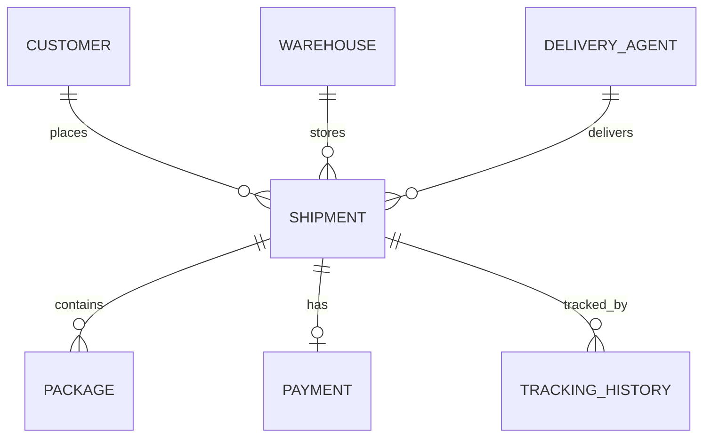

# 📦 Courier & Logistics Tracking System

A RESTful backend application built with **Spring Boot** and **PostgreSQL** for managing customers, delivery agents, warehouses, shipments, packages, payments, and shipment tracking history.

The system gives a courier company a backend to register customers, manage agents and warehouses, create shipments with automatic pricing and tracking numbers, and keep a full status timeline for every shipment.

---

## 📑 Table of Contents

1. [Key Features](#-key-features)
2. [Technology Stack](#-technology-stack)
3. [Architecture](#-architecture)
4. [Project Structure](#-project-structure)
5. [Domain Model](#-domain-model)
6. [Business Rules](#-business-rules)
7. [REST API Reference](#-rest-api-reference)
8. [Response and Error Format](#-response-and-error-format)
9. [Getting Started](#-getting-started)
10. [Example Requests](#-example-requests)
11. [Roadmap](#-roadmap)
12. [Author](#-author)

---

## ✨ Key Features

- **Customer management:** create, search (by id, email, phone), update, delete, and browse with pagination and sorting.
- **Delivery-agent management:** manage agents, search by phone or vehicle number, filter by minimum rating, and update availability.
- **Warehouse management:** manage warehouses and search by location or capacity.
- **Shipment management:** link a shipment to a customer, warehouse, and delivery agent; auto-generate a unique tracking number; calculate the price from weight and fragile packages; update status; reassign agent or warehouse.
- **Package and payment handling:** packages and payment are created together with the shipment; payment status can be updated.
- **Tracking history:** record location, status, remarks, and time for every shipment update.
- **Consistent API responses:** every endpoint returns the same `statusCode`, `message`, `data` structure.
- **Validation and error handling:** input validation (email format, 10-digit phone) and a global exception handler with proper HTTP status codes.

---

## 🛠️ Technology Stack

| Technology | Purpose |
|---|---|
| Java 21 | Language |
| Spring Boot 4.1.1 | Application framework |
| Spring Web MVC | REST APIs |
| Spring Data JPA (Hibernate) | ORM and database access |
| PostgreSQL | Relational database |
| Spring Boot Starter Validation | Bean Validation (`@Valid`, `@Email`, `@Min`, `@Max`) |
| Lombok | Removes boilerplate code |
| Maven | Build tool (Maven Wrapper included) |
| Postman | API testing |

---

## 🏗️ Architecture

```
Client (Postman)
      │
      ▼
 Controller    → receives requests, returns ResponseEntity
      │
      ▼
  Service      → business logic and rule checks
      │
      ▼
 Repository    → Spring Data JPA queries
      │
      ▼
 PostgreSQL
```

---

## 🗂️ Project Structure

```text
CourierLogisticsSystem/
├── src/main/java/CourierLogisticsSystem/
│   ├── Controller/
│   │   ├── CustomerController.java
│   │   ├── DeliveryAgentController.java
│   │   ├── WarehouseController.java
│   │   ├── ShipmentController.java
│   │   ├── PackageController.java
│   │   ├── PaymentController.java
│   │   └── TrackingHistoryController.java
│   ├── Service/
│   │   ├── CustomerService.java
│   │   ├── DeliveryAgentService.java
│   │   ├── WarehouseService.java
│   │   ├── ShipmentService.java
│   │   ├── PackageService.java
│   │   ├── PaymentService.java
│   │   └── TrackingHistoryService.java
│   ├── Repository/
│   │   ├── CustomerRepository.java
│   │   ├── DeliveryAgentRepository.java
│   │   ├── WarehouseRepository.java
│   │   ├── ShipmentRepository.java
│   │   ├── PackageRepository.java
│   │   ├── PaymentRepository.java
│   │   └── TrackingHistoryRepository.java
│   ├── Entity/
│   │   ├── Customer.java
│   │   ├── DeliveryAgent.java
│   │   ├── Warehouse.java
│   │   ├── Shipment.java
│   │   ├── Package.java
│   │   ├── Payment.java
│   │   └── TrackingHistory.java
│   ├── Enums/
│   │   ├── ShipmentStatus.java
│   │   ├── PackageType.java
│   │   ├── PaymentMethod.java
│   │   └── PaymentStatus.java
│   ├── DTO/
│   │   ├── ResponseStructure.java
│   │   └── ShipmentRequest.java
│   └── ExceptionLayer/
│       └── Custom exceptions + global exception handler
└── src/main/resources/
    └── application.properties
```

---

## 🧱 Domain Model

### Entities

| Entity | Fields |
|---|---|
| `Customer` | id, name, email (unique), phone (unique, 10 digits), address |
| `DeliveryAgent` | id, name, phone (unique, 10 digits), vehicleNo (unique), availabilityStatus, rating |
| `Warehouse` | id, name, location, capacity, contactNo (unique, 10 digits) |
| `Shipment` | id, trackingNo (unique), source, destination, weight, shipmentDateTime, deliveryDate, status |
| `Package` | id, packageType, fragile, dimension |
| `Payment` | id, amount, paymentMethod, paymentStatus, paymentDateTime |
| `TrackingHistory` | id, location, remarks, status, update time |

### Relationships

| Relationship | Type |
|---|---|
| Customer → Shipment | One-to-Many |
| Warehouse → Shipment | One-to-Many |
| DeliveryAgent → Shipment | One-to-Many |
| Shipment → Package | One-to-Many |
| Shipment → TrackingHistory | One-to-Many |
| Shipment ↔ Payment | One-to-One |



### Enums

| Enum | Values |
|---|---|
| `ShipmentStatus` | `CREATED`, `PICKED_UP`, `IN_WAREHOUSE`, `IN_TRANSIT`, `OUT_FOR_DELIVERY`, `DELIVERED`, `FAILED_DELIVERY`, `CANCELLED` |
| `PackageType` | `DOCUMENT`, `PARCEL`, `ELECTRONICS`, `CLOTHING`, `FOOD`, `FURNITURE`, `OTHER` |
| `PaymentMethod` | `CASH`, `UPI`, `CREDIT_CARD`, `DEBIT_CARD`, `NET_BANKING` |
| `PaymentStatus` | `PENDING`, `COMPLETED`, `FAILED`, `REFUNDED` |

---

## 📜 Business Rules

### Customer
- Email and phone number must be **unique**.
- Phone number must be **exactly 10 digits**.
- A customer with an **active shipment cannot be deleted**.

### Warehouse
- Contact number must be **unique** and **10 digits**.
- A warehouse that has shipments **cannot be deleted**.

### Delivery Agent
- Contact number must be **unique** and **10 digits**.
- Vehicle number must be **unique**.
- An agent with assigned shipments **cannot be deleted**.
- An **unavailable agent cannot be assigned** to a shipment.

### Shipment
- A shipment must have a **customer, warehouse, delivery agent, package(s), payment, and tracking history**.
- The **tracking number is unique** and auto-generated (10 digits).
- **Pricing is weight-based**, with an **extra charge per fragile package**:

  ```text
  amount = (weight × ₹50) + (₹100 × number of fragile packages)
  ```

- A new shipment starts as `CREATED`, with payment `PENDING`.
- The estimated delivery date is **3 days** after creation; it is replaced by the real date when the shipment is `DELIVERED`.
- Every status, agent, or warehouse change **adds a tracking-history record**.
- `DELIVERED` and `CANCELLED` shipments are **locked** and cannot be changed.

### Payment
- A `REFUNDED` payment is closed and cannot change again.
- Only a `COMPLETED` payment can be refunded.
- A `COMPLETED` payment cannot go back to `PENDING` or `FAILED`.
- Only `FAILED` or `REFUNDED` payments can be deleted.

---

## 🔌 REST API Reference

Base URL: `http://localhost:8080`

### 👤 Customer APIs

Base path: `/api/customers`

| Method | Endpoint | Description |
|---|---|---|
| `POST` | `/api/customers` | Create a customer |
| `GET` | `/api/customers` | Retrieve all customers |
| `GET` | `/api/customers/{id}` | Retrieve a customer by ID |
| `GET` | `/api/customers/email/{email}` | Find a customer by email |
| `GET` | `/api/customers/contact/{phone}` | Find a customer by phone |
| `GET` | `/api/customers/page?page=0&size=10&sort=id` | Retrieve a page of customers |
| `PUT` | `/api/customers` | Update a customer |
| `DELETE` | `/api/customers/{id}` | Delete a customer |

### 🚚 Delivery-Agent APIs

Base path: `/api/deliveryAgent`

| Method | Endpoint | Description |
|---|---|---|
| `POST` | `/api/deliveryAgent` | Create a delivery agent |
| `GET` | `/api/deliveryAgent` | Retrieve all agents |
| `GET` | `/api/deliveryAgent/{id}` | Retrieve an agent by ID |
| `GET` | `/api/deliveryAgent/phone/{phone}` | Find an agent by phone |
| `GET` | `/api/deliveryAgent/vehicle/{vehicleNo}` | Find an agent by vehicle number |
| `GET` | `/api/deliveryAgent/rating/{rating}` | Find agents at or above a rating |
| `PUT` | `/api/deliveryAgent` | Update an agent |
| `PATCH` | `/api/deliveryAgent/{id}/availability` | Update agent availability (body: `true` or `false`) |
| `DELETE` | `/api/deliveryAgent/{id}` | Delete an agent |

### 🏭 Warehouse APIs

Base path: `/api/warehouse`

| Method | Endpoint | Description |
|---|---|---|
| `POST` | `/api/warehouse` | Create a warehouse |
| `GET` | `/api/warehouse` | Retrieve all warehouses |
| `GET` | `/api/warehouse/{id}` | Retrieve a warehouse by ID |
| `GET` | `/api/warehouse/location/{location}` | Search warehouses by location |
| `GET` | `/api/warehouse/capacity/{capacity}` | Warehouses with capacity greater than the value |
| `PUT` | `/api/warehouse` | Update a warehouse |
| `DELETE` | `/api/warehouse/{id}` | Delete a warehouse |

### 🚛 Shipment APIs

Base path: `/api/shipments`

| Method | Endpoint | Description |
|---|---|---|
| `POST` | `/api/shipments` | Create a shipment (with packages, payment, and first tracking record) |
| `GET` | `/api/shipments` | Retrieve all shipments |
| `GET` | `/api/shipments/{id}` | Retrieve a shipment by ID |
| `GET` | `/api/shipments/tracking/{trackingNo}` | Find a shipment by tracking number |
| `GET` | `/api/shipments/customer/{customerId}` | Shipments of a customer |
| `GET` | `/api/shipments/warehouse/{warehouseId}` | Shipments of a warehouse |
| `GET` | `/api/shipments/agent/{agentId}` | Shipments of a delivery agent |
| `GET` | `/api/shipments/route?source=X&destination=Y` | Shipments by source and destination |
| `GET` | `/api/shipments/delivery-date/{yyyy-MM-dd}` | Shipments by delivery date |
| `GET` | `/api/shipments/page?page=0&size=5&sort=id` | Pagination and sorting |
| `PATCH` | `/api/shipments/{id}/status?status=IN_TRANSIT` | Update shipment status |
| `PATCH` | `/api/shipments/{id}/agent/{agentId}` | Assign a delivery agent |
| `PATCH` | `/api/shipments/{id}/warehouse/{warehouseId}` | Assign a warehouse |
| `DELETE` | `/api/shipments/{id}` | Delete a shipment |

### 📦 Package APIs

Base path: `/api/packages` (packages are created together with a shipment)

| Method | Endpoint | Description |
|---|---|---|
| `GET` | `/api/packages` | Retrieve all packages |
| `GET` | `/api/packages/{id}` | Retrieve a package by ID |
| `GET` | `/api/packages/type/{packageType}` | Packages by type, for example `ELECTRONICS` |

### 💳 Payment APIs

Base path: `/api/payments` (payments are created together with a shipment)

| Method | Endpoint | Description |
|---|---|---|
| `GET` | `/api/payments` | Retrieve all payments |
| `GET` | `/api/payments/{id}` | Retrieve a payment by ID |
| `PATCH` | `/api/payments/{id}/status?status=COMPLETED` | Update payment status |
| `DELETE` | `/api/payments/{id}` | Delete a payment (only `FAILED` or `REFUNDED`) |

### 📍 Tracking-History APIs

Base path: `/api/tracking-history`

| Method | Endpoint | Description |
|---|---|---|
| `POST` | `/api/tracking-history/shipment/{shipmentId}` | Add a tracking update to a shipment |
| `GET` | `/api/tracking-history` | Retrieve all tracking-history records |
| `GET` | `/api/tracking-history/{id}` | Retrieve a record by ID |
| `GET` | `/api/tracking-history/shipment/{shipmentId}` | Retrieve a shipment's tracking timeline |

---

## 📨 Response and Error Format

Every endpoint wraps its result in `ResponseStructure<T>`:

```json
{
  "statusCode": 201,
  "message": "Customer is created",
  "data": {}
}
```

### Error responses

| Situation | HTTP status | Example |
|---|:---:|---|
| Id or record not found | `404` | "Agent id is not found" |
| Duplicate email, phone, or vehicle number | `409` | "Email already exists" |
| Operation blocked by a business rule | `409` | "Delivery agent is not available" |
| Validation failed | `400` | `{ "phone": "Phone must be 10 digits" }` |

---

## 🚀 Getting Started

### Prerequisites

- JDK 21
- PostgreSQL
- IntelliJ IDEA (or any Java IDE)
- Maven (or the included Maven Wrapper)
- Postman (or any REST client)

### 1. Clone the repository

```bash
git clone https://github.com/sajalsahu/CourierLogisticsSystem.git
cd CourierLogisticsSystem
```

### 2. Create the database

```sql
CREATE DATABASE courier_logistics;
```

### 3. Configure `src/main/resources/application.properties`

```properties
spring.datasource.url=jdbc:postgresql://localhost:5432/courier_logistics
spring.datasource.username=${DB_USERNAME}
spring.datasource.password=${DB_PASSWORD}

spring.jpa.hibernate.ddl-auto=update
spring.jpa.show-sql=true
```

Set `DB_USERNAME` and `DB_PASSWORD` as environment variables, or use your local credentials. **Never commit real passwords to GitHub.**

`ddl-auto=update` is a development convenience; use schema migrations for production.

### 4. Run the application

```bash
./mvnw spring-boot:run
```

On Windows:

```bat
mvnw.cmd spring-boot:run
```

Hibernate creates all tables automatically. The server starts at `http://localhost:8080`.

---

## 🧪 Example Requests

### Create a customer

`POST /api/customers`

```json
{
  "name": "Aarav Sharma",
  "email": "aarav@example.com",
  "phone": 9876543210,
  "address": "Indore, Madhya Pradesh"
}
```

### Create a delivery agent

`POST /api/deliveryAgent`

```json
{
  "name": "Ravi Kumar",
  "phone": 9876543211,
  "vehicleNo": "MP09AB1234",
  "availabilityStatus": true,
  "rating": 4.5
}
```

### Create a warehouse

`POST /api/warehouse`

```json
{
  "name": "Indore Central Warehouse",
  "location": "Indore",
  "capacity": 500,
  "contactNo": 9876543212
}
```

### Create a shipment

`POST /api/shipments`

```json
{
  "customerId": 1,
  "warehouseId": 1,
  "deliveryAgentId": 1,
  "source": "Indore",
  "destination": "Delhi",
  "weight": 3.0,
  "paymentMethod": "UPI",
  "packages": [
    { "packageType": "ELECTRONICS", "fragile": true, "dimension": "30x20x10 cm" }
  ]
}
```

**Result:** a unique tracking number, status `CREATED`, a payment of **₹250.00** (3 kg × ₹50 + ₹100 fragile charge), and the first tracking-history record.

### Update shipment status

`PATCH /api/shipments/1/status?status=IN_TRANSIT`

### Add a tracking update

`POST /api/tracking-history/shipment/1`

```json
{
  "location": "Bhopal Warehouse",
  "remarks": "Shipment arrived at the warehouse",
  "shipmentStatus": "IN_WAREHOUSE"
}
```

---

## 🗺️ Roadmap

- [x] Spring Boot + PostgreSQL setup
- [x] Entities, relationships, and enums
- [x] Customer, Warehouse, and Delivery-Agent modules
- [x] Tracking-history module
- [x] Shipment module with pricing and business rules
- [x] Package and Payment modules
- [x] Global exception handling and validation
- [ ] Request/response DTOs to replace `@JsonIgnore`
- [ ] Unit and integration tests
- [ ] Swagger / OpenAPI documentation
- [ ] Authentication and role-based authorization
- [ ] Docker support and CI/CD

---

## 👤 Author

**Sajal Sahu**

- LinkedIn: https://linkedin.com/in/sajal-sahu
- GitHub: https://github.com/sajalsahu
